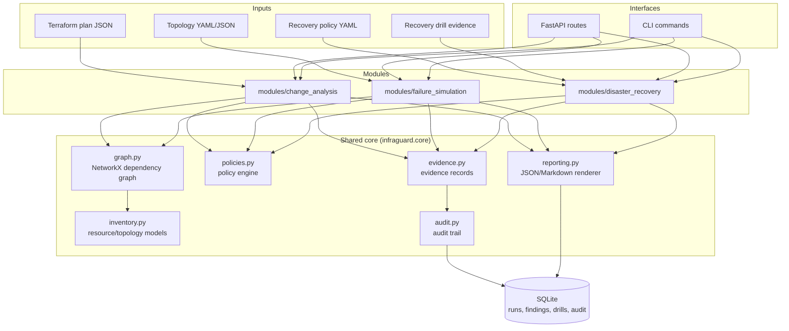

# InfraGuard Architecture

Status: proposed at Milestone 0, subject to revision as modules are built.

## 1. Shape of the system

InfraGuard is a **modular monolith**: one Python package, one FastAPI app, one CLI, one
SQLite database for history/audit — not three microservices. The three modules (Change
Analysis, Failure Simulation, Disaster Recovery) are separate Python subpackages under
`core.modules.*` that depend on shared primitives but never on each other, and are wired
together only at the API/CLI layer.

## 2. Components

- **`core/inventory.py`** — Pydantic models for infrastructure resources, dependencies,
  and the normalized topology shared by Modules A and B. A Terraform plan and a hand-written
  topology file both lower into this same resource/dependency representation so the graph
  and policy engine only need to understand one shape.
- **`core/graph.py`** — builds a `networkx.DiGraph` from the inventory, with helpers for
  reachability, blast-radius, and single-point-of-failure queries. Used by Module A
  (affected-resource analysis) and Module B (failure propagation) — one graph
  implementation, two consumers.
- **`core/policies.py`** — a deterministic rule engine: rules take a typed context (findings,
  evidence, thresholds) and return a `PolicyDecision` with severity and a `why`. Rule
  definitions are declarative (YAML/JSON) and versioned; evaluation never reaches outside its
  inputs — no implicit "missing field means pass."
- **`core/evidence.py`** — typed records distinguishing *what is known* (parsed from input),
  *what is simulated* (derived from the graph), and *what is inferred* (a heuristic finding),
  so reports never blur these together.
- **`core/audit.py`** — append-only audit event log (who/what/when for every run, decision,
  and report) persisted to SQLite.
- **`core/reporting.py`** — one report builder consumed by all three modules, emitting JSON
  and Markdown from the same underlying `Report` model so format and content stay consistent
  across modules.
- **`storage/`** — SQLite schema + a thin repository layer (no ORM migration framework at
  this scale; schema changes are additive and versioned by a `schema_version` row).
- **`modules/change_analysis/`** — Terraform plan JSON parsing, dependency-aware impact
  analysis, risk rules, CI exit-code policy.
- **`modules/failure_simulation/`** — topology validation, failure injection, blast-radius
  and redundancy analysis.
- **`modules/disaster_recovery/`** — recovery policy evaluation, backup evidence tracking,
  RTO/RPO calculation, and the optional Docker/Postgres recovery lab driver.
- **`api/`** — versioned FastAPI routers, one per capability (health, change analysis,
  topology, simulation, recovery, reports, policy).
- **`cli/`** — Click/Typer-based commands mirroring the API 1:1, sharing the same service
  layer (no logic duplicated between CLI and API — both call the same module functions).

## 3. Data flow boundaries

- Inputs are **never trusted structurally**: every input format (Terraform JSON, topology
  YAML, policy YAML, evidence JSON) is parsed into a Pydantic model with explicit validation
  errors before any analysis runs. Malformed input produces a structured error, not a crash
  or a silently-wrong result.
- The **policy engine is isolated from evidence collection** per the brief: modules produce
  findings/evidence; `core/policies.py` is the only place that turns those into pass/fail/
  severity decisions. This keeps "what did we observe" separate from "what does that mean."
- All three modules write through the same `evidence.py` → `audit.py` → SQLite path, so audit
  history has one consistent shape regardless of which module produced it.
- Reports always carry: run id, timestamp, inputs, findings, evidence, assumptions/
  limitations, policy decision, next steps — enforced by one shared `Report` model rather
  than left to each module to remember.

## 4. Key design decisions made at Milestone 0

1. **`uv` instead of Poetry** for packaging and the virtualenv. Equivalent capability
   (lockfile, reproducible installs), already installed on this machine, and can provision a
   pinned Python 3.12 interpreter without relying on the system's aging Python 3.9.6. See
   [IMPLEMENTATION_STATUS.md](IMPLEMENTATION_STATUS.md) for the full toolchain audit.
2. **Target Python 3.12** (via `uv`-managed venv), not the system `/usr/bin/python3` (3.9.6).
3. **Postgres only ever runs inside Docker Compose for the recovery lab** — there is no local
   Postgres install on this machine to accidentally target, which aligns with and reinforces
   the brief's safety constraint. The app talks to it via `psycopg` (Python driver with a
   bundled libpq), never by shelling out to `psql`.
4. **Compose invocation has a fallback**: try `docker compose` (v2 plugin syntax), fall back
   to the standalone `docker-compose` binary, because this machine's Docker CLI (via Colima)
   doesn't register the `compose` subcommand even though the standalone binary works.
5. **SQLite, no migration framework.** Schema is created idempotently at startup; changes are
   additive and guarded by a `schema_version` table. A migration tool (Alembic etc.) is
   explicitly deferred unless/until schema churn justifies it.
6. **NetworkX for all dependency/failure graphs**, shared by Modules A and B through
   `core/graph.py`, so blast-radius and SPOF logic is implemented once.
7. **No frontend dependency at the start.** CLI + FastAPI (with its automatic OpenAPI docs)
   are the primary interfaces; a lightweight dashboard is explicitly out of scope until the
   three modules work end-to-end (per the brief, Milestone 7 at the earliest).

## 5. What this document does not yet cover

Risk-scoring rule details, topology schema, and RTO/RPO calculation semantics are specified
in `docs/CHANGE_ANALYSIS.md`, `docs/FAILURE_SIMULATION.md`, and `docs/DISASTER_RECOVERY.md`
respectively — written as each module is implemented, not speculatively now.
